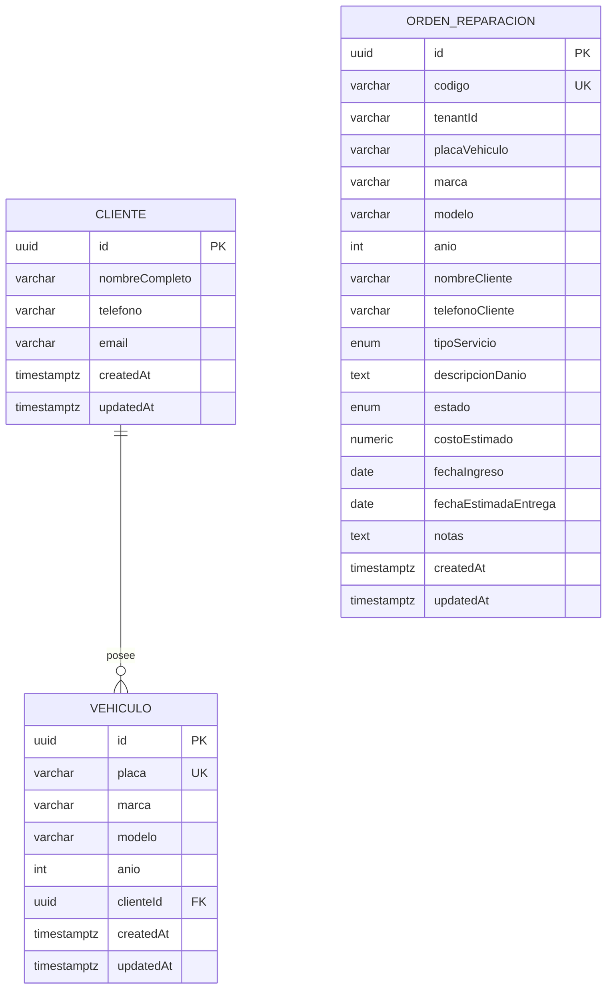

# Diagrama de entidades

## Entidades implementadas

La API conserva el contrato de órdenes de la primera etapa. Para el CRUD relacional se agregan `Cliente` y `Vehiculo`: un cliente puede tener varios vehículos y cada vehículo pertenece obligatoriamente a un cliente. La clave foránea `vehiculos.clienteId` usa `ON DELETE RESTRICT`; primero se deben eliminar los vehículos asociados para poder eliminar a su cliente.

Los campos de cliente y vehículo de `ORDEN_REPARACION` se conservan para no romper el contrato de la etapa anterior. Los nuevos endpoints de clientes y vehículos usan las tablas relacionadas descritas arriba.
